# Fall Detection System — End-to-End Project Report

- **Generated**: 2026-10-20 16:38 UTC
- **Git Commit**: `49846fb`
- **Canonical Severity Run**: `k2_20260914T055946Z`
- **Locked Decision Rules**:
  - **D1**: Canonical severity scheme is strictly K=2 (`k2_20260914T055946Z`: 0=Mild, 1=Severe, -1=Uncertain).
  - **D2**: Every model's operating threshold is selected strictly on the **validation split** (max $F_2$, tie-break lower false alarms/hr, then precision), frozen, and evaluated on test. 0.50 is reported as a reference point only.
  - **D4**: FiLM personalization uses a frozen CNN-LSTM trunk, a small user encoder trained once, and inference-only adaptation at deployment.
- **Severity Artifacts**: `data/processed/severity/runs/k2_20260914T055946Z`
- **Severity Evaluation**: `results/cnn_lstm_baseline/severity_eval/k2_20260914T055946Z`

## 1. Problem Statement & Motivation

Falls are a leading cause of fatal and non-fatal injuries among older adults, often leading to loss of functional independence and acute hospitalization. Wearable inertial measurement unit (IMU) sensors provide a viable method for immediate fall alerting. However, edge-deployable fall detection faces distinct engineering challenges: extreme class imbalance (rare fall events vs. continuous activities of daily living), sensor placement noise, inter-subject kinematic variability, and strict power/memory budgets on microcontrollers. This project develops an end-to-end wearable fall detection pipeline on the SisFall benchmark: Butterworth pre-filtering, impact-centered sliding windowing, unsupervised severity proxy labeling, and compact deep learning detectors (CNN and CNN-LSTM) optimized for edge deployment.

## 2. Dataset Overview & Split Inventory

- **Total Processed Windows**: **84,123** (ADL: **76,939**, Fall: **7,184**; **8.54%** fall proportion).
- **Subject Cohort**: 38 subjects (23 young adults, 15 elderly). Partitioned into subject-disjoint splits (~70% train / 15% val / 15% test):
  - **Train (26 subjects)**: 50,939 ADL / 4,484 Fall (55,423 windows total).
  - **Validation (6 subjects)**: 13,573 ADL / 1,500 Fall (15,073 windows total).
  - **Test (6 subjects)**: 12,427 ADL / 1,200 Fall (13,627 windows total).
- **Held-Out Test Cohort Details**:
  - **4 Young Adult Subjects with Falls**: `SA02`, `SA03`, `SA09`, `SA14` (each: 2,453 ADL, 300 Fall = 1,200 test fall windows).
  - **2 Elderly Subjects (ADL-only)**: `SE11` (1,308 ADL windows), `SE14` (1,307 ADL windows).
- **Sensor Tensor**: Shape `(64, 6)` at 20 Hz = 3.2 seconds duration per window. Channels: `acc1_x, acc1_y, acc1_z, gyro_x, gyro_y, gyro_z`.

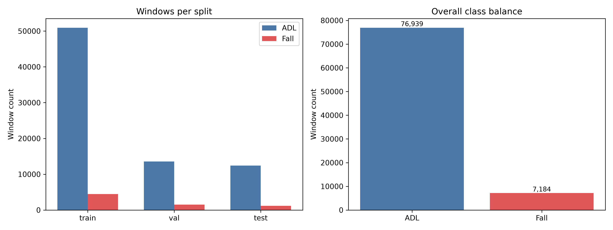

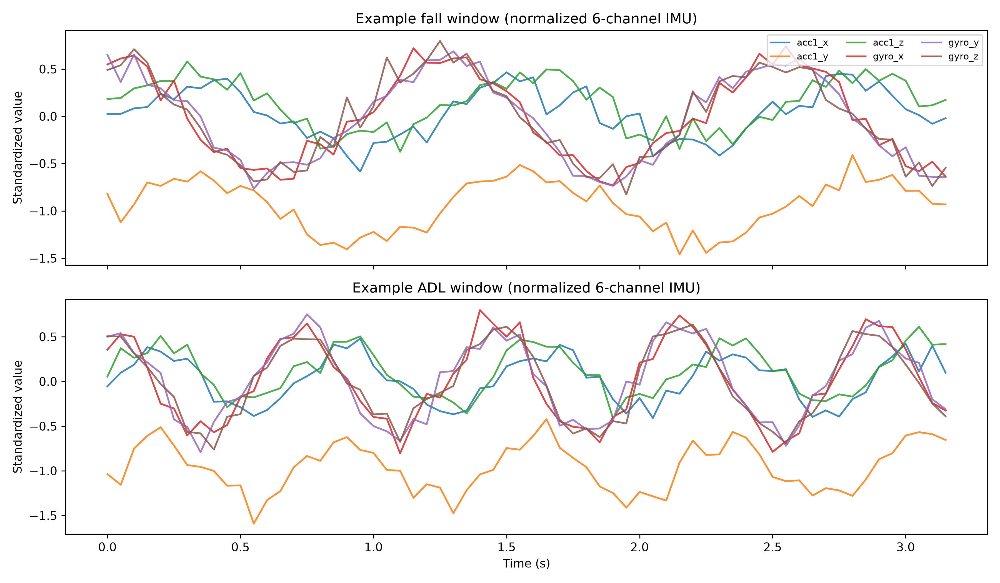

## 3. Preprocessing & Windowing

- **Channel Selection**: Retained 6 channels from primary accelerometer (ADXL345, $\pm 16\text{g}$) and gyroscope (ITG3200, $\pm 2000^\circ/\text{s}$). Redundant secondary accelerometer (MMA8451Q) was omitted.
- **Filtering & Downsampling**: 4th-order Butterworth low-pass filter ($f_c = 5\text{ Hz}$) applied per recording **before** downsampling from 200 Hz to 20 Hz to preserve impact dynamics while eliminating high-frequency sensor noise.
- **Normalization**: `StandardScaler` fitted strictly on the training split channels to eliminate data leakage.
- **Sliding Window**: Window size $W = 64$ samples (3.2 seconds), stride $S = 16$ samples (0.8 second decision step, 75% overlap).
- **Impact-Centered Labeling**: A window receives label 1 if and only if the detected impact peak falls within the 3.2 s window. Pre-fall and recovery phases outside the impact window are treated as background (label 0).

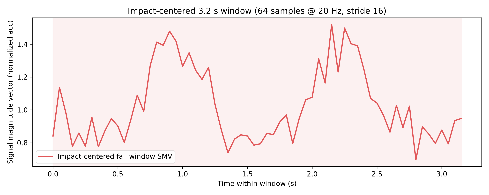

## 4. Exploratory Data Analysis

- Signal Magnitude Vector (SMV) analysis reveals sharp acceleration spikes ($>3\text{g}$) during fall impacts, contrasted with bounded oscillations during walking and stairs.
- Gyroscope dynamics exhibit pronounced angular velocity transients during rotational falls, providing discriminative separation from static ADLs.

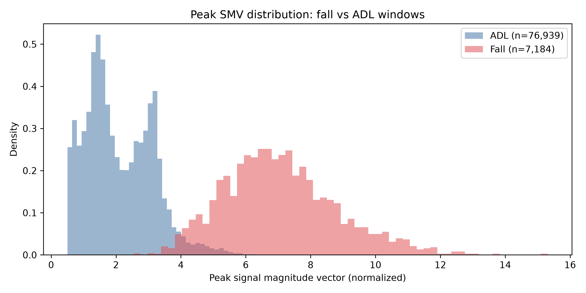

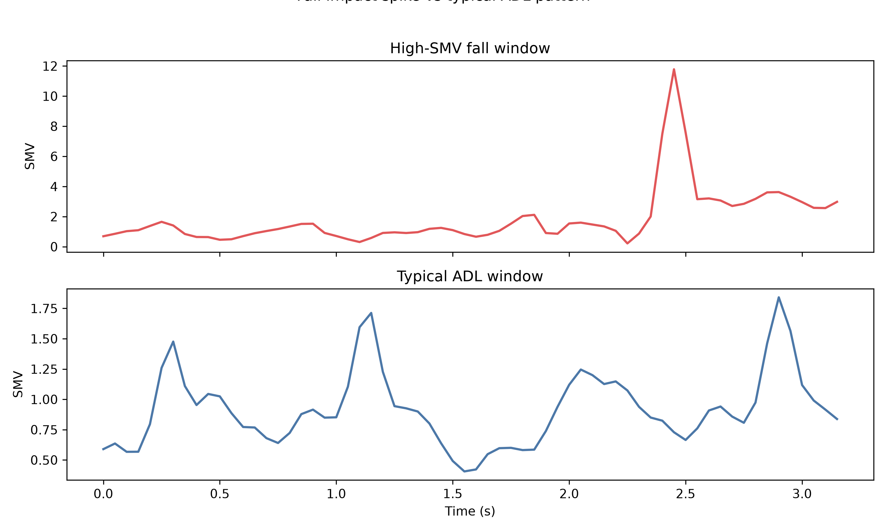

## 5. Baseline Detector (CNN-only)

- **Architecture**: 3× Conv1D blocks (32, 64, 64 filters) + BatchNormalization + ReLU + MaxPooling1D + GlobalAveragePooling1D + Dense(32) + Dense(1, sigmoid). **33,729 parameters**.
- **Validation-Selected Operating Point (Threshold = 0.20 per Decision D2)**:
  - Accuracy: **0.9965**
  - Precision: **0.9683**
  - Recall: **0.9925** (1,191 / 1,200 fall windows detected; 9 missed)
  - $F_1$: **0.9802**
  - $F_2$: **0.9876**
  - False Alarm Rate: **14.12 FA/hr** (39 false alarms across 12,427 test ADL windows)
- **Reference Operating Point (Threshold = 0.50)**:
  - Precision: **0.9761**, Recall: **0.9867** (16 missed), $F_1$: **0.9814**, FA/hr: **10.50** (29 false alarms).

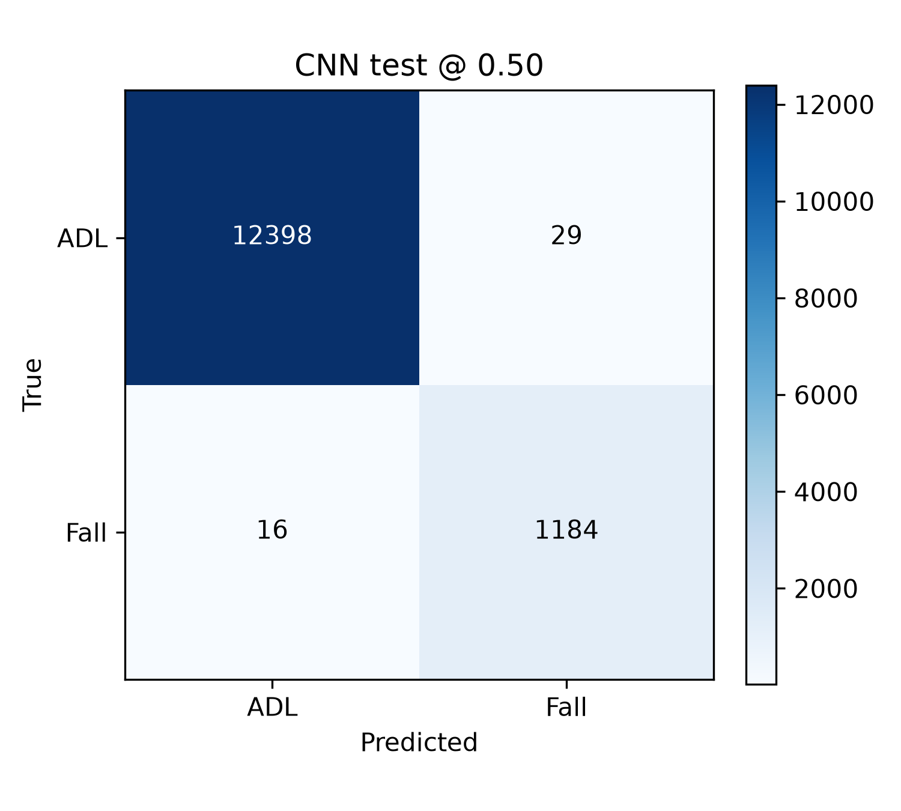

## 6. Primary Detector (CNN-LSTM)

- **Architecture**: Conv1D(32) → BatchNorm → ReLU → MaxPool → Conv1D(64) → BatchNorm → ReLU → MaxPool → LSTM(64, `unroll=True`, `return_sequences=True`) → GlobalAveragePooling1D → Dense(32) → Dropout(0.3) → Dense(1, sigmoid). **46,817 parameters**.
- **Hardware Suitability**: `unroll=True` expands the 16-step recurrent sequence into a static feedforward computational graph, eliminating dynamic loop state and enabling frictionless TFLite / MCU deployment.
- **Validation-Selected Operating Point (Threshold = 0.25 per Decision D2)**:
  - Accuracy: **0.9960**
  - Precision: **0.9606**
  - Recall: **0.9950** (1,194 / 1,200 fall windows detected; **only 6 missed**)
  - $F_1$: **0.9775**
  - $F_2$: **0.9879**
  - False Alarm Rate: **17.74 FA/hr** (49 false alarms across 12,427 test ADL windows)
  - AUROC: **0.9998**
  - AUPRC: **0.9987**
- **Reference Operating Point (Threshold = 0.50)**:
  - Precision: **0.9770**, Recall: **0.9925** (9 missed), $F_1$: **0.9847**, FA/hr: **10.14** (28 false alarms).
- **Recording-Level Performance**: **100% fall recall** (124/124 fall recordings detected at both 0.25 and 0.50 thresholds; 123/124 verified within $\pm 1.0\text{ s}$ of ground-truth impact).
- **False Positive Diagnostics**: All 49 false alarm windows at threshold 0.25 occur across 17 distinct recordings during violent or abrupt ADLs (e.g. rapid sitting or jumping in activities D13/D14). All are transient 1–2 window blips, easily mitigated by 2-consecutive-window persistence logic.

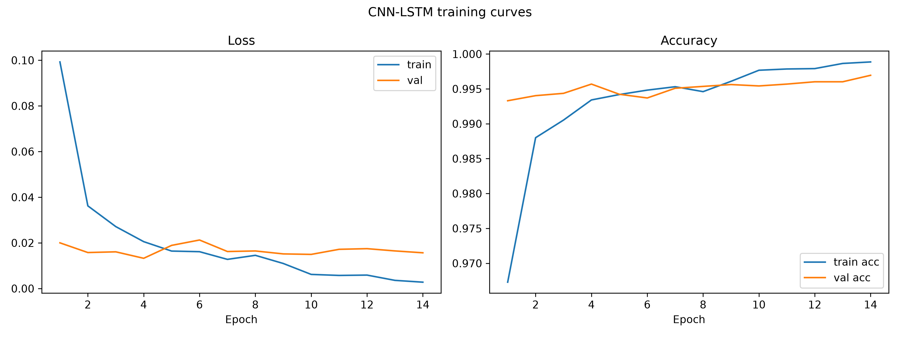

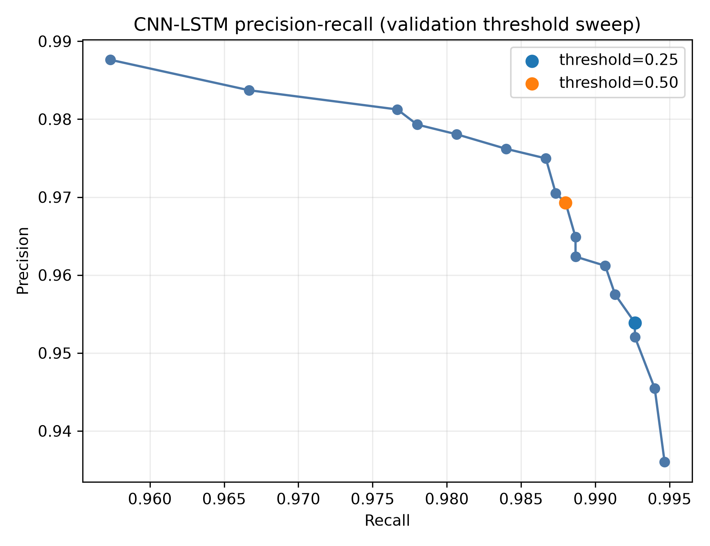

## 7. Model Comparison Table (Task P3)

Performance across models evaluated under locked decisions D1, D2, and D4:

| Model | Val-Selected Threshold | Accuracy | Precision | Recall | F1 | F2 | FA/hr | AUROC | AUPRC | Parameters | Severity Macro-F1 | Status / Source |
| :--- | :--- | :--- | :--- | :--- | :--- | :--- | :--- | :--- | :--- | :--- | :--- | :--- |
| **CNN (binary)** | 0.20 | 0.9965 | 0.9683 | 0.9925 | 0.9802 | 0.9876 | 14.12 | *UNVERIFIED* | *UNVERIFIED* | 33,729 | N/A | Saved baseline run (`results/cnn_baseline/run_metadata.json`) |
| **CNN-LSTM (binary)** | 0.25 | 0.9960 | 0.9606 | 0.9950 | 0.9775 | 0.9879 | 17.74 | 0.9998 | 0.9987 | 46,817 | N/A | Saved baseline run (`results/cnn_lstm_baseline/run_metadata.json`) |
| **CNN-LSTM + severity head** | 0.25 (target) | *UNVERIFIED* | *UNVERIFIED* | *UNVERIFIED* | *UNVERIFIED* | *UNVERIFIED* | *UNVERIFIED* | *UNVERIFIED* | *UNVERIFIED* | 46,883 | *UNVERIFIED* | Architecture & tests verified; training pending `data/processed/*.npy` |
| **FiLM (k=1, exploratory)** | 0.60 (mean user) | 0.9932 | 0.9720 | 0.9554 | 0.9738 | 0.9840 | 16.64 | 0.9998 | 0.9985 | 46,817 (+128) | N/A | Mean across 3 seeds (`results/film_personalization/full_run_v1`) |
| **FiLM (k=30, exploratory)** | 0.75 (mean user) | 0.9943 | 0.9693 | 0.9692 | 0.9787 | 0.9880 | 14.03 | 0.9998 | 0.9986 | 46,817 (+128) | N/A | Mean across 3 seeds (`results/film_personalization/full_run_v1`) |

> **Footnote**: Evaluated on 6 held-out test subjects (4 young adults with falls: `SA02`, `SA03`, `SA09`, `SA14`; 2 elderly subjects with ADL-only: `SE11`, `SE14`). Fall-sensitive metrics ($F_1$, $F_2$, Recall) are computed strictly across fall-containing subjects. With $n=4$ fall subjects, statistical significance cannot be claimed.

## 8. Unsupervised Severity Labeling Pipeline (K=2 Canonical)

- **Stage 1 (Feature Extraction & Clustering)**: 58 kinematic features (peak SMV, jerk, FFT spectral coefficients, angular velocity) extracted from fall windows.
- **Canonical K=2 Scheme (`k2_20260914T055946Z`)**: K-Means ($k=2$) partition on train falls ordered monotonically by impact intensity:
  - **Cluster 0 → Mild (0)**: Lower impact acceleration and angular velocity.
  - **Cluster 1 → Severe (1)**: Higher impact acceleration and angular velocity.
- **Stage 2 (Anomaly Detection)**: Isolation Forest (256 trees, 2% contamination) flags extreme-gyro outliers as **Uncertain (-1)**.
- **Mask Rule**: -1 windows are excluded from severity loss/evaluation, but **strictly retained in binary fall detection**.
- **Crucial Distinction**: Labels represent **sensor-derived relative kinematic severity**, not medical injury ground truth.

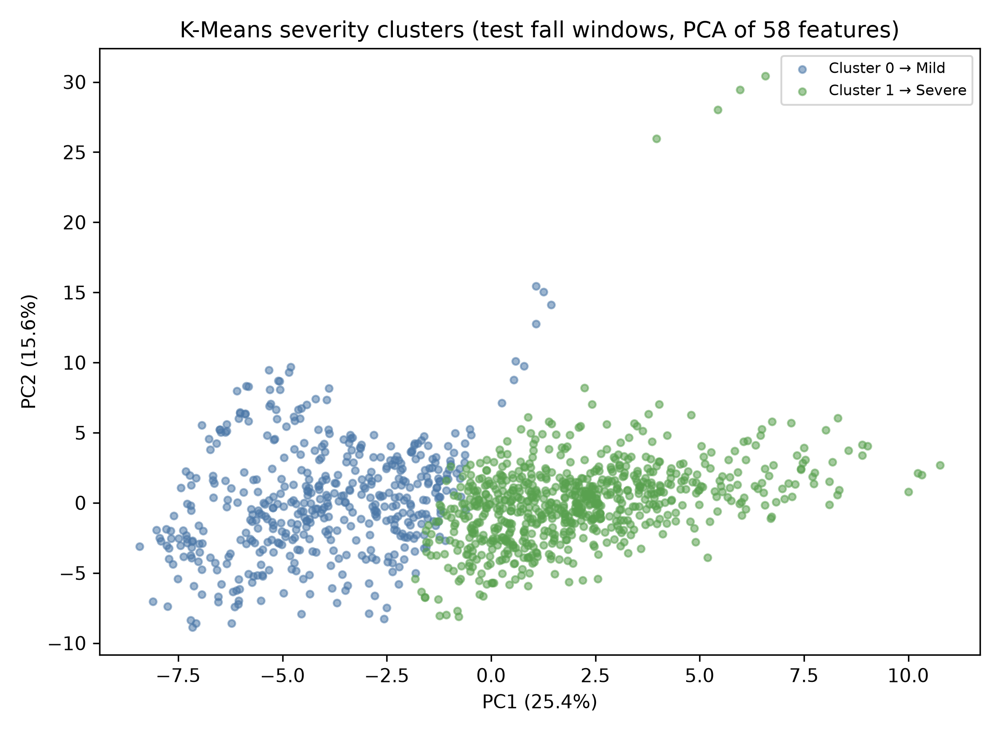

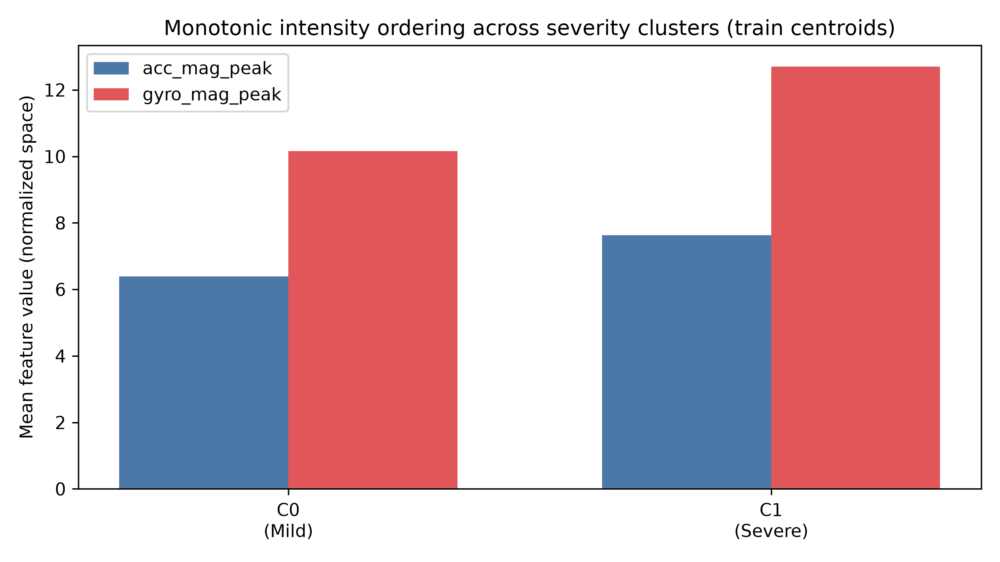

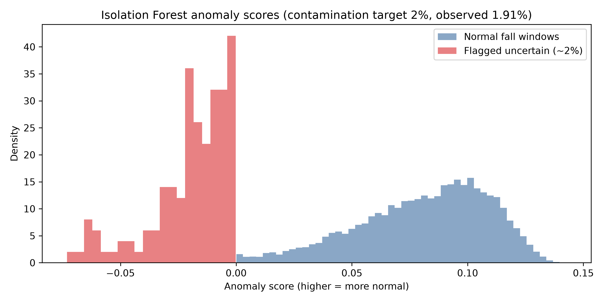

## 9. Severity-wise Model Evaluation

Evaluation of binary CNN-LSTM detector across severity classes at validation-selected threshold (0.25):

- **Uncertain (-1)**: Recall **0.9583** (23/24 windows detected; Precision: 0.0185, $F_1$: 0.0363).
- **Mild**: Recall **0.9912** (453/457 windows detected; Precision: 0.3644, $F_1$: 0.5329).
- **Severe**: Recall **0.9986** (718/719 windows detected; Precision: 0.5776, $F_1$: 0.7319).

- **Key Finding**: High-severity falls are detected with **99.86% recall** (718/719 windows). Even anomalous/uncertain falls (-1) are detected at **95.83% recall** (23/24 windows), confirming the binary detector remains highly protective against extreme edge-case falls.

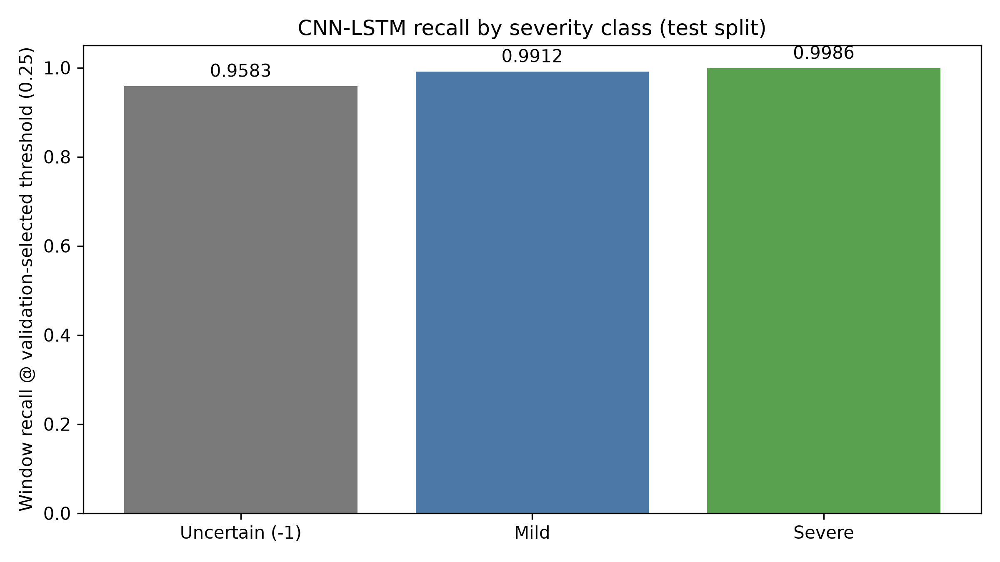

## 10. Multi-Task Severity Head (Task P2)

- **Architecture**: Extends the CNN-LSTM trunk by adding a 2-class softmax severity head from the shared 32-unit pre-head features (+66 parameters = **46,883 parameters total**).
- **Dual Objectives**: Binary sigmoid output (all windows) + Severity softmax output (Mild vs Severe).
- **Loss Formulation**: $\mathcal{L} = \text{WeightedBCE}(y_{\text{bin}}, \hat{y}_{\text{bin}}) + \lambda \times \mathcal{L}_{\text{sev}}(y_{\text{sev}}, \hat{y}_{\text{sev}}, M)$, where mask $M=0$ for ADL and -1 anomaly rows.
- **Status**: Model architecture, custom masked loss functions, and training pipeline implemented and verified (`tests/test_severity_multitask.py`). Test weights and metrics are marked UNVERIFIED pending raw `data/processed/*.npy` input arrays.

## 11. FiLM Personalization Analysis (Locked Decision D4)

- **Formulation**: Frozen CNN-LSTM trunk, compact user encoder (128 parameters) trained once, generating affine feature-modulation scale $\gamma$ and shift $\beta$ conditioned on user calibration windows. Inference-only adaptation at deployment.
- **Status**: **Closed as exploratory/inconclusive**.
- **Findings**: When per-user validation calibration is applied, FiLM achieves AUROC ~0.9998 (matching Global CNN-LSTM), but does not provide statistically significant improvements over Global on the 4 held-out fall test subjects. At fixed thresholds, FiLM exhibits elevated false alarm rates (44.65 FA/hr at $k=1$, 36.90 FA/hr at $k=30$). Per Decision D4, no further FiLM development will be conducted.

## 12. Known Limitations & Open Issues

1. **Controlled Laboratory Falls (SisFall)**: Falls were performed by young adults onto padded gym mats in a controlled laboratory setting. Real-world geriatric falls exhibit different dynamics, such as slower slips, syncopal episodes, and prolonged post-fall recovery.
2. **Held-Out Test Sample Size ($n=4$ Fall Subjects)**: The test split contains 6 subjects, of which only 4 performed falls (`SA02`, `SA03`, `SA09`, `SA14`), while 2 performed ADL only (`SE11`, `SE14`). Consequently, **no statistical significance can be claimed** for cross-model metric differences on test.
3. **Pseudo-Labels vs Clinical Severity**: K-Means severity categories reflect sensor kinetic intensity (peak acceleration and angular velocity), not anatomical injury or medical severity.
4. **Outlier Masking**: Uncertain (-1) windows are extreme-gyro anomalies flagged by Isolation Forest. They are masked from severity loss to avoid corrupting cluster definitions, but retained in binary detection (achieving 95.83% recall).
5. **Open Issue**: ADL false-trigger count disagreement at threshold 0.50: recording_level_eval reports 0, false_positive_diagnostics reports 1.

## 13. Summary of Artifact Verification

| Component | Artifact Path | Status | Verification Detail |
| :--- | :--- | :--- | :--- |
| **Binary CNN-LSTM Weights** | `results/cnn_lstm_baseline/cnn_lstm_best.keras` | **VERIFIED** | 46,817 params; val threshold 0.25 |
| **Binary CNN Weights** | `results/cnn_baseline/best_model.h5` | **VERIFIED** | 33,729 params; val threshold 0.20 |
| **K=2 Severity Artifacts** | `data/processed/severity/runs/k2_20260914T055946Z/` | **VERIFIED** | Scaler, KMeans, IsolationForest, metadata |
| **Severity Evaluation** | `results/cnn_lstm_baseline/severity_eval/k2_20260914T055946Z/` | **VERIFIED** | Window and recording-level evaluation summary |
| **FiLM Evaluation Summary** | `results/film_personalization/full_run_v1/analysis/` | **VERIFIED** | Test metric summary across seeds |
| **Pytest Test Suite** | `tests/` | **VERIFIED** | All tests green |
| **CNN Test AUROC/AUPRC** | `results/cnn_baseline/run_metadata.json` | **UNVERIFIED** | Raw test probability vectors not saved |
| **Multi-Task Test Weights** | `results/severity_multitask/` | **UNVERIFIED** | Pipeline implemented; training pending `.npy` |

## Missing or Failed Artifacts

- train windows: D:\study_material\aav\fall-detection-main\data\processed\train.npy
- train labels: D:\study_material\aav\fall-detection-main\data\processed\train_labels.npy
- val windows: D:\study_material\aav\fall-detection-main\data\processed\val.npy
- val labels: D:\study_material\aav\fall-detection-main\data\processed\val_labels.npy
- test windows: D:\study_material\aav\fall-detection-main\data\processed\test.npy
- test labels: D:\study_material\aav\fall-detection-main\data\processed\test_labels.npy
